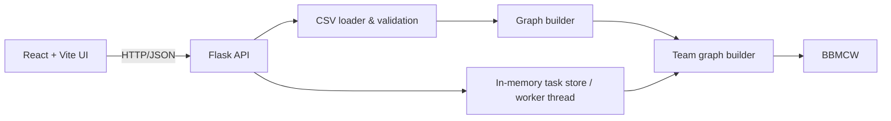
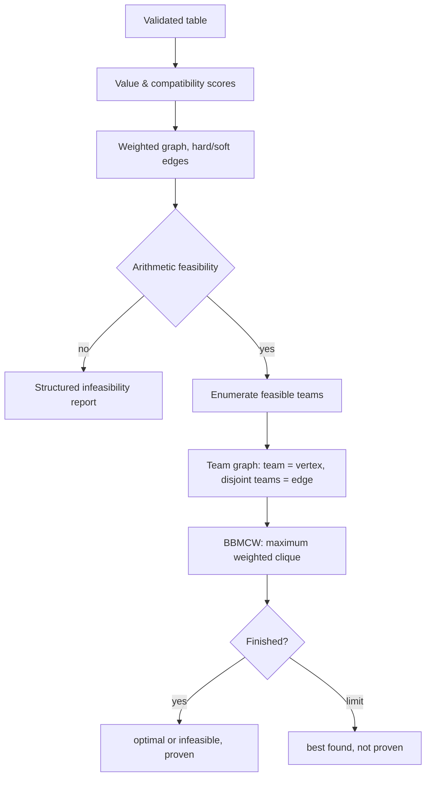

# Optimal Team Formation via Maximum Weighted Clique, Branch-and-Bound and Coloring Bounds

Full-stack academic project: React + Vite + TypeScript + Tailwind frontend, Flask backend, exact optimisation in pure Python.
Teams are formed with the BBMCW algorithm from San Segundo, Furini & Artieda, *"A New Branch-and-Bound Algorithm for the Maximum Weighted Clique Problem"*, Computers & Operations Research, 2019.

> **Honest scope statement.**
> * `backend/optimization/bbmcw.py` implements the algorithm **as described in the paper's text** (Branching/Pruned Sets, partial colouring
>   with loads, splitting rules R1-R3, COVER, MCOVER, GenBranchSet, degeneracy ordering). The paper solves the *classical vertex-weighted* MWCP.
>   This code differs from the paper in: greedy initial incumbent instead of AMTS, no colour-sort ordering, no "3 vertices per independent set" cap,
>   and the printed MWCP gap update (garbled in the text extraction) is recomputed from the bound definition. It is verified by brute-force
>   comparison and a test of the Pruned-Set property, **not** by reproducing the paper's benchmark tables.
> * Team formation needs team-size limits, pairwise (edge) weights and several teams, which the paper does not address. `team_conflict_solver.py`
>   **reduces team formation to the classical problem** and runs BBMCW on the result (see below). The reduction and the team-count, coverage and
>   packing-bound additions are this project's own work, not the paper's.
> * The earlier solver (`multi_team_solver.py`, `mwcp_solver.py`) does not use the paper's algorithm. It is kept as an independent comparison.
> * Compare page / `python -m evaluation.benchmark` show all of them.

## Quick start
The UI (**CliqueCraft**) opens on an entrance page, then a step-by-step wizard (one question per screen: upload → row labels → columns → role and importance per column → team size → everyone in a team → run). Results, Graph, Compare (coloring on/off, greedy, brute force) and Export follow. Light and dark themes are available.
```bash
# backend (Python 3.11+)
cd backend && python -m venv .venv && source .venv/bin/activate   # Windows: .venv\Scripts\activate
pip install -r requirements.txt
python run.py                      # http://127.0.0.1:5000

# frontend (Node 18+), second terminal
cd frontend && npm install && npm run dev     # http://localhost:5173  (proxies /api to :5000)

# tests / benchmark
cd backend && python -m pytest tests -q
python -m evaluation.benchmark --random-n 16 --density 0.7 --seed 3 --team-size 3 --teams 3
```
Demo fixture (optional): `backend/sample_data/students.csv` + `sample_schema.json` + `sample_settings.json`
(ID column `student_id`). In the UI upload the CSV, add features (or paste the schema from the JSON), validate, then optimise.
To use your own data, upload your CSV and define features that match *your* column names — nothing is hard-coded.

## Mathematical model
Vertices = candidates. Per feature f (importance `imp_f`, role value/compat/both/none):
* **Candidate value** `w_i = Σ imp_f·value_f(i) / Σ imp_f` over value features, in [0,1]. Numeric: min-max normalised (range from the user or the data; `lower_better` flips it). Binary: 0/1. Categorical: **user-supplied** `category_values` (never invented).
* **Pair compatibility** `c_ij = Σ imp_f·pair_f(i,j) / Σ imp_f` over compatibility features, in [0,1]. Numeric similarity `1-|a-b|/range`; complementarity `|a-b|/range`; categorical/binary equality (or its complement), or a user compatibility matrix (must be complete).
* **Edges**: `hard` mode — edge iff `c_ij ≥ threshold` (a non-edge means the pair can *never* share a team); `soft` mode — complete graph, `c_ij` is only a quality weight. In hard mode `c_ij` both gates edges and contributes to the score (a documented double use; set β=0 to avoid it).
* **Team score** `TeamScore(C) = α·Σ_{i∈C} w_i / k + β·Σ_{i<j∈C} c_ij / C(k,2)`, with `k` = preferred team size. For a team of `k` members this is α·(mean value) + β·(mean pairwise compatibility), so both terms are on a [0,1] scale. Because the score is a *sum*, bigger teams / more teams tend to score higher; use the size rules and the coverage priority to control this.
* **Exactness** is with respect to this objective and the chosen constraints only.

### From team formation to the paper's problem
The classical MWCP returns one clique, and repeating "best clique, remove, repeat" is a greedy heuristic that is **not** globally optimal (see `test_greedy_is_suboptimal_where_exact_succeeds`). Instead the app builds a second graph, the **team graph**, and solves one MWCP on it:
* one vertex per feasible team (a clique of the candidate graph with size in `[min,max]`), so size limits decide which vertices exist;
* vertex weight = `TeamScore`, so pairwise compatibilities are folded into a plain vertex weight;
* an edge between two teams iff they share no candidate.

A clique of the team graph is exactly a set of non-overlapping teams and its weight is their total score, so **its maximum weighted clique is the best assignment**. BBMCW runs on it with its bound, Branching Set and Pruned Set unchanged. Rules the graph cannot express (team count, full coverage, equal sizes, at most one short team) are enforced by rejecting invalid cliques as incumbents and removing vertices that cannot lead to a valid improvement. This keeps the search exact, because BBMCW only prunes cliques that cannot beat the incumbent. `coverage_first` uses weight `size·M + score` with `M` larger than any total score, which is exactly lexicographic.

Teams are chosen **jointly**: a set of vertex-disjoint cliques with sizes in `[min,max]`, count in `[teams_min,teams_max]`, maximising lexicographically
`(assigned candidates, total score)` (priority `coverage_first`) or `(total score)` (`quality_first`), ties broken by a fixed deterministic search order.

### Algorithms
1. `optimization/bbmcw.py` — the paper's algorithm for the classical MWCP (see scope statement). Optional `accept` / `restrict` arguments add the team rules; they are off by default.
2. `optimization/team_conflict_solver.py` — **the app's team solver**: enumerates feasible teams, builds the team graph with the paper's degeneracy ordering, and calls BBMCW. Above 20 000 possible teams it keeps each candidate's best teams of each size; such a result is never reported as proven.

Kept for comparison (none of these use the paper's algorithm):
* `optimization/mwcp_solver.py` — exact size-constrained weighted-clique B&B.
* `optimization/coloring_bound.py` — bound derivation in the module docstring. A *proper* greedy colouring of the candidate set splits it into independent classes; a clique takes ≤1 vertex per class and ≤m vertices (m = remaining capacity). Per-vertex bounds `b_v = w_v + Σ_{u∈R} c_uv + ½·(sum of the m−1 largest incident pair weights)` make the bound valid with pair terms; the bound is the sum of the m largest class maxima. Without colouring the bound is the sum of the m largest `b_v` (always ≥ the colouring bound). Both are valid, so pruning never removes an optimum; tests check this exhaustively on small states.
* `optimization/multi_team_solver.py` — the earlier team solver: enumerates all feasible team cliques (memory-capped), computes the exact best team per smallest vertex with the MWCP solver, then runs an outer B&B that, at the lowest undecided vertex, opens a team there or leaves it unassigned. Every assignment is generated once. Node bound: `coverage ≤ covered + min(free, r·size_cap)`, `quality ≤ q + Σ(top r best-team values)`.
* `greedy_baseline.py` (heuristic) and `brute_force_reference.py` (independent, tiny n) for comparison and testing.

Statuses: `optimal` (search finished, proven), `infeasible` (exhaustive search or arithmetic check: no valid assignment), `feasible_not_proven` (stopped by time/node limit with an incumbent), `no_solution_found` (stopped before any valid assignment), `too_large` (team enumeration exceeded the cap), `heuristic` (greedy fallback, only if the user allowed it). A stopped search is never reported as optimal.

### Leftover policies (resolved into explicit constraints, nothing is silently relaxed)
| Policy | Meaning |
|---|---|
| A `leave_unassigned` | all teams exactly preferred size; leftovers reported |
| B `variable_sizes` | sizes in [min,max]; unassigned allowed unless full coverage is ticked |
| C `smaller_final_team` | sizes ≤ preferred, at most one team smaller than preferred (≥ min); full coverage by default |
| D `strict_equal` | all teams exactly preferred size; floor(n/size) teams unless a count is given |
| E `full_coverage` | every candidate in exactly one team |

Example (n=50, preferred 4): A/D → 12 teams, 48 assigned; B/E with 12 teams and sizes 4–5 → feasible (10×4 + 2×5); C → 13 teams = 12×4 + 1×2. These are computed from the settings by `check_feasibility`, not hard-coded; they say nothing about optimality. Infeasible settings return structured issues with suggestions (HTTP 422); settings are never changed automatically.

## Architecture


Repository: `backend/{api,data,graph,optimization,evaluation,tests,sample_data}`, `frontend/src/{pages,components,services,types}`.

## API (all JSON; errors: `{ok:false,error:{code,message,details}}`)
`GET /api/health` · `POST /api/preview-data` · `POST /api/validate-csv` · `POST /api/validate-configuration` (JSON) · `POST /api/build-graph` (optional `explain_pair=idA,idB`) · `POST /api/optimize` (202 + `task_id`) · `GET /api/optimization/<id>` (status/progress) · `/results` · `/statistics` · `POST /cancel` · `GET /export?format=teams_csv|unassigned_csv|json|stats_json|summary_txt` · `POST /api/evaluate` (colouring on/off, greedy, brute force for n ≤ 9).
Multipart fields: `file`, `schema` (JSON feature list), `id_column`, `settings` (JSON: `objective`, `team`, `limits`).
Design: optimisation runs in a background thread per task with polling and cancellation; task state is in memory only (lost on restart), no database, uploads are parsed in memory and never written to disk or executed. Limits: 5 MB upload, 5000 rows, 300 candidates, 600 s, restrictive CORS, no stack traces in responses.

## Interpreting evaluation
Compare rows with the *same* settings. "proven optimum" rows share a guarantee; "heuristic" rows do not. Pruning efficiency = bound-pruned branches / branches considered. Colouring is **not** guaranteed to help.
Measured here (this machine, Python 3.12, random graphs from `evaluation.benchmark`, 3 repeats):

| instance | method | runtime | nodes | objective | guarantee |
|---|---|---|---|---|---|
| n=16, d=0.73, 3 teams of 3 | multi-team exact, colouring on | 3.1 ms | 527 | 13.7462 | proven |
| same | colouring off | 2.9 ms | 527 | 13.7462 | proven |
| same | greedy | 0.7 ms | – | 13.7462 | heuristic |
| n=22, d=0.5, 3 teams of 4 | single-team MWCP, colouring on / off | 0.3 / 0.3 ms | 15 / 16 | 7.2734 | proven |
| same | multi-team exact on / off | 8.4 / 6.8 ms | 1810 / 1810 | 18.4391 | proven |

On these small instances colouring gave **no measurable speed-up** (the multi-team phase is dominated by the outer search; colouring only affects the MWCP phase). Do not infer a speed-up from them. Greedy happened to match the optimum here; the test-suite contains a constructed instance where it cannot.

The new team solver against the earlier one, same 20 s limit, one run each (Python 3.14; the demo data is `sample_data`, the others are complete random graphs):

| instance | BBMCW team graph | earlier solver |
|---|---|---|
| demo, 3 teams of 3 | proven, 2.04 s, 4.7578 | proven, 0.08 s, 4.7578 |
| demo, 4 teams of 3 | proven, 7.68 s, 6.2541 | proven, 0.44 s, 6.2541 |
| demo, 8 teams of 3 | not proven, 11.5674 | not proven, **11.5734** |
| demo, 5 teams of 4-5 | not proven, **9.9280** | not proven, 9.8768 |
| 30 people, teams of 4 | not proven, **49.251** | not proven, 48.346 |
| 50 people, teams of 4 | not proven, **83.868** | not proven, 81.851 |
| 100 people, teams of 3 | not proven, **138.979** | not proven, 136.306 |

So the earlier solver proves small cases faster, and the new solver usually, not always, finds better teams on larger ones. **Most of that gain comes from the greedy starting solution, not from BBMCW's search:** on the three largest rows the starting solution alone already beat the earlier solver, and BBMCW then added 0.13, 1.13 and 0.00. On the three demo rows it added 0.00 (4 teams of 3), 0.09 (8 teams of 3) and 0.06 (5 teams of 4-5). BBMCW's main contribution is the proof where the search finishes. The three largest rows searched only part of the team graph because of the 20 000 limit. These are small samples and say nothing about the paper's published benchmarks.

Paper-style vs adapted solver, classical vertex-weighted MWCP, one random graph per row, single run, Python 3.12, this machine
(integer weights 1-100):

| n | density | paper-style BBMCW | adapted, colouring on | adapted, colouring off |
|---|---|---|---|---|
| 60 | 0.5 | 0.005 s / 34 nodes | 0.028 s / 172 | 0.086 s / 669 |
| 80 | 0.8 | 0.041 s / 516 | 0.786 s / 2791 | 9.43 s / 36 976 |

All three returned the same optimum. These are small random instances and a Python implementation; they say nothing about the paper's published benchmarks.
Here the paper-style algorithm was faster and colouring helped the adapted solver, in contrast to the small team-formation instances above.

## Known limitations
* Exact search is exponential. On the 24-candidate demo data, 5 teams of 4–5 and 8 teams of 3 did **not** finish a proof within 20 s (status `feasible_not_proven`); 4 equal teams of 3 proved optimal in about 8 s. Proofs are practical only for a handful of teams or sparser graphs (raise the threshold).
* All feasible teams are enumerated first (cap `max_cliques`, default 250 000); dense graphs with large teams hit `too_large`. A labelled greedy fallback is available only if enabled. Between 20 000 and that cap the team graph is reduced and the result is not proven.
* The UI's `use_coloring` setting no longer affects team formation, because BBMCW always uses its own bound. It only applies to the earlier solver.
* The wizard uses soft edges (a complete graph), so "everyone in a team" with 24 candidates and teams of 4 is already above the 20 000-team limit.
* `numpy` is a pandas dependency; the solver uses Python integers (bitsets) rather than NumPy.
* No authentication, persistence or multi-user isolation beyond per-task state. Single process; tasks are lost on restart.
* Hard-mode compatibility is used both as an edge rule and as a score term (see above).
* Unassigned-candidate explanations are limited to what the solver can substantiate.

## Future improvements
The paper's AMTS initial solution and colour-sort ordering, stronger packing bounds (LP/Lagrangian), decomposition by connected components, persistence, a pairwise "why no edge" UI, parallel search.

## Citation
P. San Segundo, F. Furini, J. Artieda. *A new branch-and-bound algorithm for the Maximum Weighted Clique Problem.* Computers & Operations Research, vol. 110, pp. 18–33, 2019. DOI: 10.1016/j.cor.2019.05.017.

(Metadata checked against publisher/repository records; the full text was not consulted for this project. Not to be confused with San Segundo, Coniglio, Furini & Ljubić, *A new branch-and-bound algorithm for the maximum edge-weighted clique problem*, EJOR 278, 2019.)
