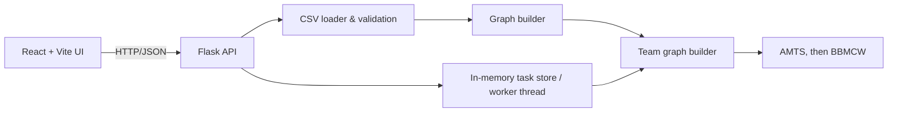
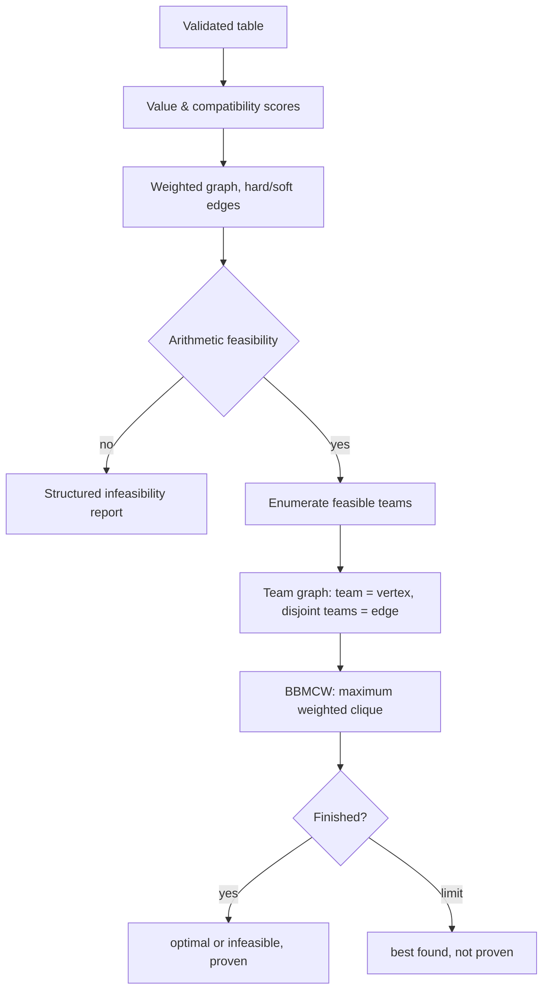

# Optimal Team Formation with the BBMCW Algorithm for the Maximum Weighted Clique Problem

Full-stack academic project: React + Vite + TypeScript + Tailwind frontend, Flask backend, exact optimisation in pure Python.
Teams are formed **only** by the algorithms in San Segundo, Furini & Artieda, *"A New Branch-and-Bound Algorithm for the Maximum Weighted Clique Problem"*, Computers & Operations Research, 2019: AMTS for the initial solution, then BBMCW.

> **Honest scope statement.**
> * `optimization/bbmcw.py` implements the paper's Algorithms 1-5, rules R1-R3, both initial orderings with the choice at the root, and the 3-vertex limit. `optimization/amts.py` implements AMTS, which the paper names but only cites, following Wu & Hao (2013). It was compared step by step with the preprint, and `tests/test_paper_examples.py` reproduces the paper's Figure 1 result, R3 example and Section 3 demonstration. It does **not** reproduce the paper's benchmark tables.
> * Where this code departs from the printed text: Algorithm 3 (steps 9, 17) and Algorithm 5 (step 4) print gap formulas that disagree with the paper's own example in Section 3, and the code follows the example. The paper gives no details for the 3-vertex limit, weighted AMTS or COLOUR SORT beyond a sentence, so those details are this project's reading. They are listed in the module docstrings.
> * Not from the paper, because the paper has no teams: modelling teams as a graph (the same pattern as its Section 4.4 applications), the rule checks that enforce team count, coverage and sizes, and the cap of 20 000 team-graph vertices. None of these changes the bound.
> * Python, not the paper's C++. Speeds are not comparable with the paper's.

## Quick start
The UI (**CliqueCraft**) opens on an entrance page, then a step-by-step wizard (one question per screen: upload → row labels → columns → role and importance per column → team size → everyone in a team → run). Results, Graph, Compare (BBMCW with parts switched off) and Export follow. Light and dark themes are available.
```bash
# backend (Python 3.11+)
cd backend && python -m venv .venv && source .venv/bin/activate   # Windows: .venv\Scripts\activate
pip install -r requirements.txt
python run.py                      # http://127.0.0.1:5000

# frontend (Node 18+), second terminal
cd frontend && npm install && npm run dev     # http://localhost:5173  (proxies /api to :5000)

# tests / benchmark
cd backend && python -m pytest tests -q
python -m evaluation.benchmark --random-n 16 --density 0.7 --seed 3 --team-size 3 --teams 3
```
Demo fixture (optional): `backend/sample_data/students.csv` + `sample_schema.json` + `sample_settings.json`
(ID column `student_id`). In the UI upload the CSV, add features (or paste the schema from the JSON), validate, then optimise.
To use your own data, upload your CSV and define features that match *your* column names — nothing is hard-coded.

## Mathematical model
Vertices = candidates. Per feature f (importance `imp_f`, role value/compat/both/none):
* **Candidate value** `w_i = Σ imp_f·value_f(i) / Σ imp_f` over value features, in [0,1]. Numeric: min-max normalised (range from the user or the data; `lower_better` flips it). Binary: 0/1. Categorical: **user-supplied** `category_values` (never invented).
* **Pair compatibility** `c_ij = Σ imp_f·pair_f(i,j) / Σ imp_f` over compatibility features, in [0,1]. Numeric similarity `1-|a-b|/range`; complementarity `|a-b|/range`; categorical/binary equality (or its complement), or a user compatibility matrix (must be complete).
* **Edges**: `hard` mode — edge iff `c_ij ≥ threshold` (a non-edge means the pair can *never* share a team); `soft` mode — complete graph, `c_ij` is only a quality weight. In hard mode `c_ij` both gates edges and contributes to the score (a documented double use; set β=0 to avoid it).
* **Team score** `TeamScore(C) = α·Σ_{i∈C} w_i / k + β·Σ_{i<j∈C} c_ij / C(k,2)`, with `k` = preferred team size. For a team of `k` members this is α·(mean value) + β·(mean pairwise compatibility), so both terms are on a [0,1] scale. Because the score is a *sum*, bigger teams / more teams tend to score higher; use the size rules and the coverage priority to control this.
* **Exactness** is with respect to this objective and the chosen constraints only.

### From team formation to the paper's problem
The classical MWCP returns one clique, and repeating "best clique, remove, repeat" is **not** globally optimal (see `test_finds_the_joint_optimum_that_greedy_misses`). Instead the app builds a second graph, the **team graph**, and solves one MWCP on it:
* one vertex per feasible team (a clique of the candidate graph with size in `[min,max]`), so size limits decide which vertices exist;
* vertex weight = `TeamScore`, so pairwise compatibilities are folded into a plain vertex weight;
* an edge between two teams iff they share no candidate.

A clique of the team graph is exactly a set of non-overlapping teams and its weight is their total score, so **its maximum weighted clique is the best assignment**. BBMCW runs on it with its bound, Branching Set and Pruned Set unchanged. Rules the graph cannot express (team count, full coverage, equal sizes, at most one short team) are enforced by rejecting invalid cliques as incumbents and removing vertices that cannot lead to a valid improvement. This keeps the search exact, because BBMCW only prunes cliques that cannot beat the incumbent. `coverage_first` uses weight `size·M + score` with `M` larger than any total score, which is exactly lexicographic.

Teams are chosen **jointly**: a set of vertex-disjoint cliques with sizes in `[min,max]`, count in `[teams_min,teams_max]`, maximising lexicographically
`(assigned candidates, total score)` (priority `coverage_first`) or `(total score)` (`quality_first`), ties broken by a fixed deterministic search order.

### Algorithms
1. `optimization/amts.py` — AMTS, the initial solution (paper p. 17; details from Wu & Hao 2013).
2. `optimization/bbmcw.py` — COLOR, COVER, MCOVER, GenBranchSet and the search; degeneracy and colour-sort orderings. `accept` and `restrict` add the team rules and are off by default.
3. `optimization/team_conflict_solver.py` — lists feasible teams, builds the team graph, and runs AMTS then BBMCW on it. Above 20 000 possible teams it keeps each candidate's best teams of each size; such a result is never reported as proven.

No other algorithm can produce teams. `tests/brute_force.py` exists only to check answers in the tests.

Statuses: `optimal` (search finished, proven), `infeasible` (exhaustive search or arithmetic check: no valid assignment), `feasible_not_proven` (stopped by time/node limit with an incumbent), `no_solution_found` (stopped before any valid assignment), `too_large` (team enumeration exceeded the cap). A stopped search is never reported as optimal.

### Leftover policies (resolved into explicit constraints, nothing is silently relaxed)
| Policy | Meaning |
|---|---|
| A `leave_unassigned` | all teams exactly preferred size; leftovers reported |
| B `variable_sizes` | sizes in [min,max]; unassigned allowed unless full coverage is ticked |
| C `smaller_final_team` | sizes ≤ preferred, at most one team smaller than preferred (≥ min); full coverage by default |
| D `strict_equal` | all teams exactly preferred size; floor(n/size) teams unless a count is given |
| E `full_coverage` | every candidate in exactly one team |

Example (n=50, preferred 4): A/D → 12 teams, 48 assigned; B/E with 12 teams and sizes 4–5 → feasible (10×4 + 2×5); C → 13 teams = 12×4 + 1×2. These are computed from the settings by `check_feasibility`, not hard-coded; they say nothing about optimality. Infeasible settings return structured issues with suggestions (HTTP 422); settings are never changed automatically.

## Architecture


Repository: `backend/{api,data,graph,optimization,evaluation,tests,sample_data}`, `frontend/src/{pages,components,services,types}`.

## API (all JSON; errors: `{ok:false,error:{code,message,details}}`)
`GET /api/health` · `POST /api/preview-data` · `POST /api/validate-csv` · `POST /api/validate-configuration` (JSON) · `POST /api/build-graph` (optional `explain_pair=idA,idB`) · `POST /api/optimize` (202 + `task_id`) · `GET /api/optimization/<id>` (status/progress) · `/results` · `/statistics` · `POST /cancel` · `GET /export?format=teams_csv|unassigned_csv|json|stats_json|summary_txt` · `POST /api/evaluate` (BBMCW with parts switched off, as in the paper's Section 4.5).
Multipart fields: `file`, `schema` (JSON feature list), `id_column`, `settings` (JSON: `objective`, `team`, `limits`).
Design: optimisation runs in a background thread per task with polling and cancellation; task state is in memory only (lost on restart), no database, uploads are parsed in memory and never written to disk or executed. Limits: 5 MB upload, 5000 rows, 300 candidates, 600 s, restrictive CORS, no stack traces in responses.

## Interpreting evaluation
The Compare page runs the paper's BBMCW with parts switched off, as in its Section 4.5: without MCOVER, without COVER and MCOVER, and without AMTS. Compare rows with the *same* status.

Measured on Python 3.14, 20 s limit, one run each. First rows of `sample_data`, with the wizard's settings (anyone can team with anyone):

| people, team size | possible teams | result | time | score |
|---|---|---|---|---|
| 12, teams of 3 | 220 | proven | 0.03 s | 5.3696 |
| 12, teams of 4 | 495 | proven | 0.01 s | 3.9874 |
| 15, teams of 3 | 455 | proven | 2.22 s | 7.0296 |
| 16, teams of 4 | 1 820 | proven | 3.99 s | 5.6654 |
| 18, teams of 3 | 816 | not proven | 20 s | 8.4659 |
| 21, teams of 3 | 1 330 | not proven | 20 s | 9.8892 |
| 24, teams of 3 | 2 024 | not proven | 20 s | 11.4506 |

These small samples say nothing about the paper's published benchmarks. On the 15-person team graph, one run each, COVER and MCOVER cut search nodes by 0.2% to 5% depending on the chosen columns and were slower overall. On classical random graphs they cut nodes by up to nearly 6×, the same direction as the paper's Section 4.5. A likely reason, not tested, is that heavily overlapping teams make colour classes weak.

## Known limitations
* Exact search is exponential, and the paper's bound is weak on team graphs. Proofs are practical for about 16 people. Beyond that the result is valid but `feasible_not_proven`.
* All feasible teams are enumerated first (cap `max_cliques`, default 250 000); dense graphs with large teams hit `too_large`. Between 20 000 and that cap the team graph is reduced and the result is not proven.
* The wizard uses soft edges (a complete graph), so "everyone in a team" with 24 candidates and teams of 4 is already above the 20 000-team limit.
* No authentication, persistence or multi-user isolation beyond per-task state. Single process; tasks are lost on restart.
* Hard-mode compatibility is used both as an edge rule and as a score term (see above).
* Unassigned-candidate explanations are limited to what the solver can substantiate.

## Future improvements
From the paper's future work (p. 28): the reNumber local search, incremental MaxSAT reasoning, and conflict-directed clause learning. Also running the DIMACS and BHOSHLIB graphs to compare with its tables.

## Citation
P. San Segundo, F. Furini, J. Artieda. *A new branch-and-bound algorithm for the Maximum Weighted Clique Problem.* Computers & Operations Research, vol. 110, pp. 18–33, 2019. DOI: 10.1016/j.cor.2019.05.017.

(Implementation compared with the 36-page preprint submitted on 26 March 2019, not the final journal typesetting. Not to be confused with San Segundo, Coniglio, Furini & Ljubić, *A new branch-and-bound algorithm for the maximum edge-weighted clique problem*, EJOR 278, 2019.)
